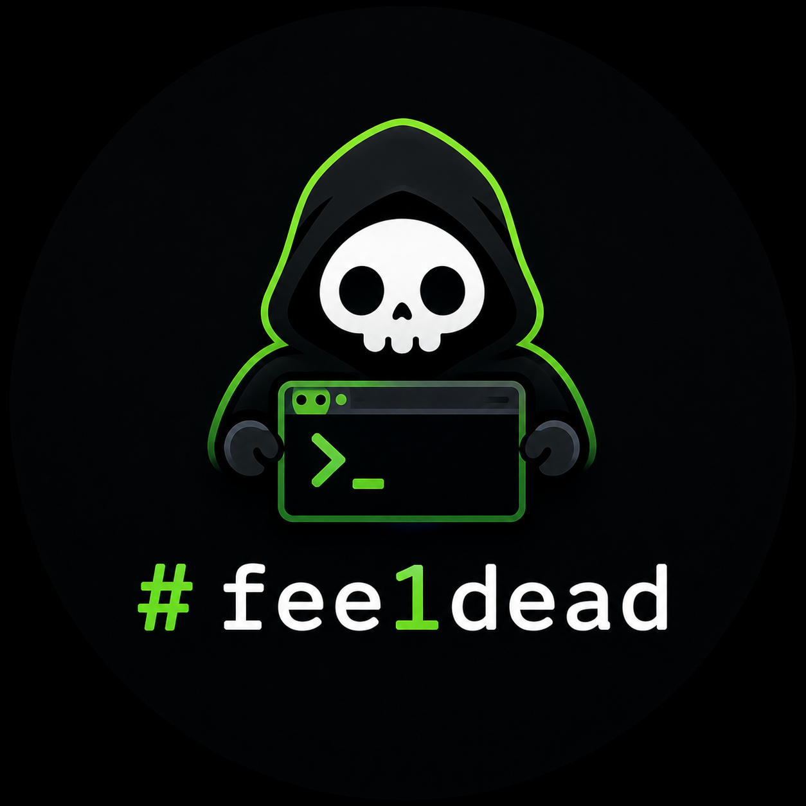

# fee1dead



An AI-CLI-agnostic vulnerability discovery harness. An orchestrator drives AI
coding CLIs through a staged pipeline, running many narrow agent tasks in
parallel and turning their output into queryable, schema-validated findings.

The orchestrator does **not** hunt bugs itself. It schedules work, manages
per-task scratch space, and validates/persists results.

## Pipeline

| Stage      | Status   | What it does |
|------------|----------|--------------|
| Recon      | built    | Reads the repo top-down, emits a structured threat model (`recon.json`) and seeds the hunt queue from its `hunt_tasks`. Past runs' feedback seeds reach it as leads, which it admits or drops by the same bar as its own tasks. |
| Hunt       | built    | One hunter per task (attack class + scope + a falsifiable hypothesis and concrete `targets` to start from), run concurrently, each in its own scratch dir. Hunters **fork from recon's session** (toggle `run.fork_hunters`) so they inherit its codebase context; cold hunters load `recon.json` instead. **Incremental:** skips already-hunted tasks, so re-queues get a fresh pass. Spawn order is priority first, so unvetted gapfill tasks never jump ahead of recon's high-priority ones. Each hunter's output is saved as soon as it finishes; a hunter whose answer does not parse, or that times out, gets one repair turn in its own session. The same repair applies to recon and validate. Emits candidate findings + gap markers; PoCs are copied to `out_dir/pocs/<finding id>/`. |
| Validate   | built    | Independent reviewers re-read the code and **tag every finding** (`fp-check` skill), in parallel batches of up to 8 findings grouped by file: `confirmed` / `downgraded` (with corrected severity) / `likely_false_positive` / `needs_review` (inconclusive, or skipped by the reviewer). Each reviewer also writes the finding's `impact` and `recommendation`. **Never drops** a finding: a real-but-unproven bug is surfaced as `needs_review`, not discarded. Incremental, so `--resume` reviews only what a failed batch left. |
| Gapfill    | built    | Re-queues areas hunters flagged as under-covered (`origin = gapfill`), deduped against the existing queue. |
| Dedupe     | built    | Collapses findings sharing a root cause (same file and attack class, and the same line or a similar title); the highest-severity finding survives, the rest go to `duplicates.jsonl`. |
| Skip-reported | built | Prunes candidates already reported in the sink (e.g. filed as GitHub issues) **before validate**, so no validation tokens are spent re-reviewing them. A token-overlap (Jaccard) score decides the confident cases; only the ambiguous middle band is escalated to a lightweight judge model (`stages.models.skip-reported`, default `claude-haiku-4-5` on claude-code), which fails open so a real finding is never silently dropped. No-op unless the sink tracks external state (github). |
| Aggregate  | built    | Joins the hunters' raw output (`candidates.jsonl` + `gaps.jsonl`) and each finding's recon task lead into one reviewable `findings.json`, with each finding's review (verdict, evidence, impact, recommendation) once validate has run, ordered by effective severity then confidence with likely false positives last, and the findings Dedupe collapsed listed separately. **No agent call**, so it always completes. The default config runs it last; run it standalone on a partial run with `fee1dead aggregate`. |
| Feedback   | built    | Cross-run memory: distils confirmed findings (hunt variants) and unresolved gaps into durable seed tasks in `feedback-seeds.jsonl`. The next run's recon reads them as leads and queues the ones that pass its admission bar, so each run starts smarter. |
| Report     | built    | Builds a `schema/finding.schema.json` record for every reportable finding (all but `likely_false_positive`) from the finding and its review, then persists via the configured sink. **No agent call.** Each record carries its `verdict`; the github sink labels `needs_review` issues `needs-review`. |

Stages communicate only through artifacts in `out_dir` (`queue.jsonl`,
`candidates.jsonl`, `gaps.jsonl`, `duplicates.jsonl`, `validated.jsonl`,
`findings.json`, `hunted.jsonl`, `recon.json`, `run-id.txt`), so they are
decoupled and runs are resumable. A recon-led run clears those per-run artifacts
at startup; `feedback-seeds.jsonl` is the one durable artifact and survives,
carrying learning between runs. **Reuse the same `out_dir` (mount) across runs to
keep the feedback memory.**

Finding ids are `<run id>-<task id>-F<nn>`, so a finding never shares an id with
another run's (sinks like github and a reused sqlite db key on it).

A failed stage is logged and the stages after it still run; the run then exits
non-zero naming the failed stages. To continue a run a usage limit or crash
stopped, run `fee1dead run --resume` (or `just resume`): it skips recon, keeps
every artifact, and hunts the tasks not yet processed.

The full agent transcript of each run is teed live to `out_dir/logs/` (one
`<stage>-<label>.jsonl` per agent: the provider's raw event stream), so a
run can be replayed or debugged after the fact — a transcript survives even if
its agent times out. Its final `result` event also carries that agent's cost and
token usage (`total_cost_usd`, `duration_ms`, `num_turns`, and a `usage` block
with token counts and prompt-cache hits), so the harness keeps no separate cost
file — profile a run straight from the logs, e.g.:

```sh
jq -s 'map(select(.type=="result") | .total_cost_usd) | add' out_dir/logs/*.jsonl
```

Each agent is also told to write its complete final answer to
`agent-final-output.json` in its working dir; the harness reads that file back as
the result (falling back to the stream's final event if the agent didn't write
it) and mirrors it next to the transcript as `out_dir/logs/<stage>-<label>.output.json`,
so each agent's answer is visible in the out dir without reaching into its scratch
dir. The `logs/` directory is cleared at the start of a recon-led run.

## Architecture

Single Rust binary, modularized:

- `src/provider/` — `AgentRunner` trait + adapters. `claude-code` and `opencode`
  are built in (see [Choosing the AI CLI](#choosing-the-ai-cli)); **any other
  CLI** is a config block (`type = "exec"`) with no Rust code. `MockRunner`
  (feature `mock-runner`) drives offline runs.
- `src/pipeline/` — orchestrator + one file per stage.
- `src/store/` — `ReportSink` trait + SQLite/JSONL/HTTP/GitHub-issue sinks. The
  `github` sink files one issue per reportable finding into `report.repo`
  (`owner/name`), authenticating with a PAT read from `report.token_env`
  (default `GITHUB_PAT`); it is idempotent across re-runs via a hidden per-finding
  marker in each issue body. Add `api.github.com` to `[firewall].allow`. The
  `github` sink also exposes `ReportSink::existing_reports` (its already-filed
  issues), which the `skip-reported` stage consumes to prune duplicates before
  validate (see below).
- `src/config.rs` — per-run TOML config, validated at load.
- `prompts/`, `schema/` — embedded into the binary at build time.
- `skills/` — the Trail of Bits plugin suite. Recon suggests skills per task and the stage prompts name them.

## Configure

Edit `config/harness.toml`: target repo path, provider, concurrency, firewall
allow-list, report sink, and which stages to run.

```bash
fee1dead check          --config config/harness.toml   # validate config
fee1dead firewall-hosts --config config/harness.toml   # print allow-list
fee1dead run            --config config/harness.toml   # run the pipeline
fee1dead run --resume   --config config/harness.toml   # continue the last run in out_dir
```

### Choosing the AI CLI

Two adapters are built in. Switch by pointing `provider.default` at the block
you want — everything else in the pipeline is unchanged.

```toml
[provider]
default = "claude-code"   # or "opencode"

[providers.claude-code]
type       = "claude-code"
model      = "claude-opus-5"
extra_args = ["--dangerously-skip-permissions"]
# max_weekly_usage_pct = 80  # optional: stop starting agents at 80% weekly usage

[providers.opencode]
type    = "opencode"
model   = "anthropic/claude-opus-5"  # opencode's provider/model form
# agent   = "build"   # optional: a configured opencode agent (--agent)
# variant = "high"    # optional: reasoning effort (--variant), provider-specific
auto    = true        # auto-approve permissions (--auto); the container is the boundary
extra_args = []
```

Any agent stage can run on its own model; unset stages use the provider's
`model`. Forked hunters reuse recon's prompt cache only on the same model, so
keep `hunt` and `recon` together unless you have measured otherwise.

```toml
[stages.models]          # keys: recon, hunt, validate, skip-reported
validate      = "claude-opus-5"
skip-reported = "claude-haiku-4-5"   # the default on claude-code
```

The `opencode` adapter runs `opencode run --format json` and consumes the same
event stream / final-answer-file contract as the claude-code one, so transcripts
still land in `out_dir/logs/`. It authenticates the way opencode itself does
(e.g. `ANTHROPIC_API_KEY` in the environment, or the credentials in
`~/.local/share/opencode/auth.json`, which the `just` recipes mount along with
`~/.cache/opencode`).

`model` must be opencode's `provider/model` form — a bare id like `kimi-k3` is
rejected at config load, because opencode itself reports it only as an opaque
"Unexpected server error". `opencode models` lists what your auth can reach.
`[firewall].allow` needs, beyond your target's own hosts:

- `models.dev` — the model catalogue; nothing resolves without it.
- `registry.npmjs.org` — the provider SDK packages opencode installs on demand.
- your model provider's API host (`api.anthropic.com`, `api.moonshot.ai`, …)
  and `opencode.ai` if you use opencode zen.

Differences worth knowing before switching:

| Knob | claude-code | opencode |
|------|-------------|----------|
| `run.fork_hunters` | yes | yes (`--session … --fork`) |
| Per-tool allow/deny lists | enforced | no equivalent; ignored |
| Reasoning effort per stage | `CLAUDE_CODE_EFFORT_LEVEL` | fixed `variant` from config |
| Trail of Bits skills | registered as personal skills | not registered; prompts name them but the agent must find them under `/opt/skills` |
| `max_weekly_usage_pct` | yes (subscription auth) | no equivalent |
| `stages.models.skip-reported` | defaults to `claude-haiku-4-5` | defaults to the provider's `model`; set the `provider/model` form to override |

Any other CLI is a `type = "exec"` block with no Rust code (`{prompt}` and
`{working_dir}` are substituted per task).

## Run in Docker (default-deny egress)

The agent runs unrestricted **inside** the container
(`--dangerously-skip-permissions`); the only real restriction is the firewall,
which default-denies egress and allows only the hosts in `[firewall].allow`.

The easiest path is the `justfile` (run `just` to list recipes):

```bash
just image                       # build the image
just run target=/path/to/repo    # mount a local repo and run
just run-clone                   # harness clones the repo itself (see below)
just resume                      # continue the last run in ./out (skips recon)
just shell                        # interactive shell in the image
```

### Target the repo by clone (instead of mounting)

Set `[target]` in `config/harness.toml` and the harness clones the repo into
`target_dir` at startup. The git host must be in `[firewall].allow` (the clone
runs after the firewall is up).

```toml
[target]
repo    = "https://github.com/org/name.git"
ref     = "main"                # branch, tag, or commit SHA; optional
prepare = ["go mod download"]   # optional: run in target_dir before any stage
```

`prepare` commands run with `sh -c` in `target_dir` (mounted or cloned) before
recon, e.g. to fill the package cache agents need to read dependency source. A
failing command warns and the run continues. Config keys are strict: an unknown
key fails `fee1dead check` instead of being ignored.

Then `just run-clone` (no local target mount needed). With `[target]` unset, the
harness expects `target_dir` to already contain the code (the mounted case).

### Reference spec / known-good implementation

Set `[reference]` to clone a spec or reference implementation and expose it to
the recon, hunt, and validate agents as ground truth — its path is added to each
agent's readable dirs and named in their prompts. When a reference is set, recon
also emits dedicated `spec-to-code-compliance` hunt tasks (a spec clause paired
with its implementing code), and those hunters apply the `spec-to-code-compliance`
skill. Useful for spec conformance (e.g. the BOLT specs for a Lightning
implementation). The git host must also be in `[firewall].allow`.

```toml
[reference]
repo = "https://github.com/lightning/bolts.git"
ref  = "master"           # optional
dir  = "/work/reference"  # where to clone it; defaults to /work/reference
```

Or directly:

```bash
docker build -t fee1dead -f docker/Dockerfile .

docker run --rm \
  --cap-add=NET_ADMIN \
  -e ANTHROPIC_API_KEY \
  -v /path/to/target/repo:/work/target:ro \
  -v "$PWD/out":/work/out \
  fee1dead
```

**Auth:** set one of these on the host before running (the `just` recipes
forward both, using whichever is set):
- `ANTHROPIC_API_KEY` — API-key billing.
- `CLAUDE_CODE_OAUTH_TOKEN` — Claude Pro/Max OAuth; generate with
  `claude setup-token`. For a raw `docker run`, add `-e CLAUDE_CODE_OAUTH_TOKEN`.

With the `opencode` provider, auth is opencode's own: pass the model provider's
key (e.g. `-e ANTHROPIC_API_KEY`) or mount your credentials and its cache — the
`just` recipes do the latter:

```
-v "$HOME/.local/share/opencode":/home/agent/.local/share/opencode \
-v "$HOME/.cache/opencode":/home/agent/.cache/opencode
```

`--cap-add=NET_ADMIN` is required for the firewall. The container is **not**
`--privileged`. Set `FEE1DEAD_SKIP_FIREWALL=1` (or `just run-nofw`) only for
local debugging.

The image bundles both CLIs (`ARG CLAUDE_CODE_VERSION`, `ARG OPENCODE_VERSION`),
**Go** (`ARG GO_VERSION`) and **Python 3 + uv** alongside Node
so hunters can compile PoCs and run Python tooling (several Trail of Bits skills
use `uv run`). `go build` and Python package installs fetch at run time, so the
relevant hosts (`proxy.golang.org`, `sum.golang.org`, `storage.googleapis.com`,
`pypi.org`, `files.pythonhosted.org`, …) must be in `[firewall].allow` — see
`config/lnd.toml` for a worked example.

## Develop

```bash
cargo test --features mock-runner    # unit tests + offline end-to-end pipeline
```

The end-to-end test (`tests/e2e.rs`) runs the full skeleton against the
`MockRunner` with no network or API cost.
